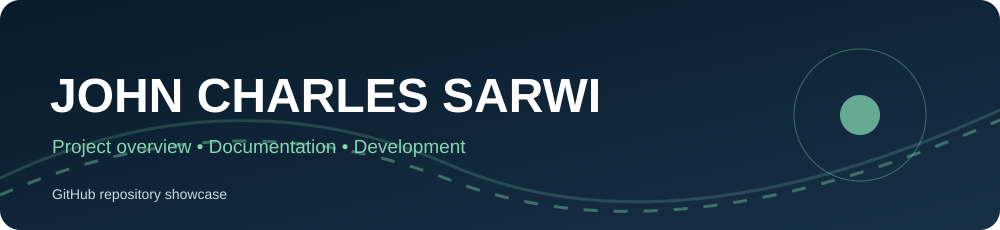
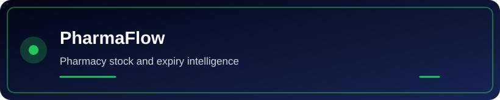
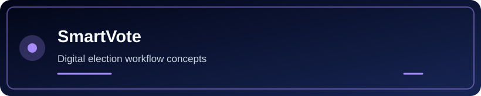
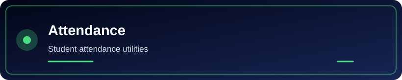
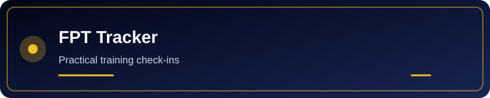
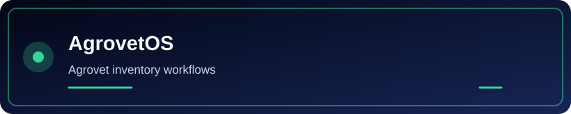
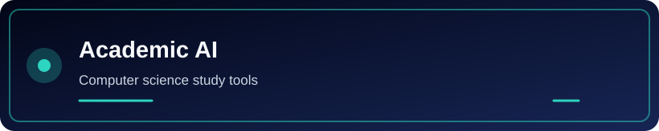

<div align="center">
  
</div>

 <div align="center">

<!-- JOHN CHARLES SARWI — SIGNATURE BRAND -->


<br/>

<a href="https://github.com/johncharlessarwi-dot">

</a>
<a href="https://github.com/johncharlessarwi-dot?tab=followers">

</a>
<a href="https://github.com/johncharlessarwi-dot?tab=repositories">

</a>

<br/><br/>

<a href="https://bizflow-ai-xi.vercel.app">

</a>
<a href="https://john-charles-sarwi-portfolio.vercel.app/">

</a>
<a href="https://www.freelancer.in/u/johnsarwi0002">

</a>
<a href="mailto:johncharlessarwi@gmail.com">

</a>

</div>

---

<div align="center">

### `01` — THE PERSON BEHIND THE CODE


### JOHN CHARLES SARWI
**Computer Science Student • Software Developer • AI Builder**

🇹🇿 Tanzania | 🌍 Global Vision | 🚀 Building the Future

</div>

I'm **John Charles Sarwi**, a Computer Science undergraduate at **Mwenge Catholic University (MWECAU), Moshi, Tanzania**, and a **software developer in Tanzania** building full-stack web applications, AI-powered products, and practical business systems.

I build for two audiences: **recruiters and engineering teams** looking for an emerging software developer for internships, junior software roles, and remote opportunities; and **Tanzanian entrepreneurs, startups, and small and growing businesses** that need websites, custom software, POS/ERP platforms, or workflow automation through **JOHN ONLINE SERVICES AND APPLICATIONS**.

My work explores software engineering, artificial intelligence, automation, and business technology. I share practical projects and development activity here, with a fuller overview, selected case studies, and contact details on my [official developer portfolio](https://john-charles-sarwi-portfolio.vercel.app/).

- 🧠 Exploring AI-powered applications and intelligent workflows.
- 💻 Building modern web applications and digital platforms.
- ⚙️ Turning repetitive processes into smarter workflows.
- 📊 Exploring business intelligence, automation, and data-driven decisions.
- 🚀 Growing **JOHN ONLINE SERVICES AND APPLICATIONS**.
- 🌍 Building from Tanzania with a global mindset.

<div align="center">


</div>

---

## `02` — MY DIGITAL ARMORY

<div align="center">

### ⚡ Languages & Frontend


### 🛠️ Backend & Databases


### 🔥 Tools & Infrastructure


<br/>


</div>

---

## `03` — THE PROJECT MULTIVERSE

<div align="center">


</div>

<table>
<tr>
<td width="50%" valign="top">

<h3>🧠 BizFlow AI</h3>


An AI-assisted business management project focused on helping businesses understand and organize their operations.

**Core areas**
- 📦 Products and inventory workflows
- 💰 Sales, purchases, and expenses
- 📈 Reports and business insights
- 🤖 AI-assisted commands and decisions

<a href="https://bizflow-ai-xi.vercel.app"><b>EXPLORE BIZFLOW AI ↗</b></a>

</td>
<td width="50%" valign="top">

<h3>🗳️ SmartVote AI</h3>


A software project exploring digital election processes, structured information, and election-related data experiences.

**Core areas**
- 🗳️ Digital election workflows
- 📊 Data visualization concepts
- 🛡️ Security-conscious design
- 🧩 Structured application interfaces

<a href="https://github.com/johncharlessarwi-dot/smartvote-platform"><b>EXPLORE SMARTVOTE ↗</b></a>

</td>
</tr>

<tr>
<td width="50%" valign="top">

<h3>💊 WPMS</h3>


**Wambuxy Pharmaceutical Management System**

A pharmacy-management project designed around medicine inventory and pharmacy operations.

**Core areas**
- 💊 Stock and batch management
- ⏰ Expiry and low-stock monitoring
- 🧾 Sales and reporting workflows
- 🏢 Multi-branch operations

<a href="https://github.com/johncharlessarwi-dot/pms_wambura"><b>EXPLORE PUBLIC PHARMAFLOW REPOSITORY ↗</b></a>

</td>
<td width="50%" valign="top">

<h3>🌐 John Online Services</h3>


My digital-services initiative supporting students, job seekers, graduates, and businesses.

**Core areas**
- 🎓 Online application assistance
- 💻 Websites and digital solutions
- 🎨 Graphics and promotional materials
- 🤝 Technology support and services

<a href="https://github.com/johncharlessarwi-dot"><b>EXPLORE MY GITHUB ↗</b></a>

</td>
</tr>
</table>

<div align="center">

### Additional public projects

- [FPT Attendance Tracker](https://github.com/johncharlessarwi-dot/ismani_fpt_att) — Flask trainee attendance registration with server-side validation.
- [John Attendance System](https://github.com/johncharlessarwi-dot/JOHN-ATTENDANCE-SYSTEM) — attendance management components and utilities.

- [Campus Connect](https://github.com/johncharlessarwi-dot/campusconnectapp) — campus information and student support platform.
- [SafeNet](https://github.com/johncharlessarwi-dot/safe-net) — network access and FreeRADIUS management project.
- [MWECAU DigiVote](https://github.com/johncharlessarwi-dot/mwecau_digivote_laravel) — Laravel-based digital voting project.

**The mission:** Build technology that makes real work easier.

</div>

---

## Animated project spotlights

Explore short animated cards for selected public repositories. Animations respect reduced-motion preferences.

<details>
<summary><strong>PharmaFlow</strong> — Pharmacy stock and expiry intelligence</summary>

[](https://github.com/johncharlessarwi-dot/pms_wambura)

[Explore PharmaFlow repository](https://github.com/johncharlessarwi-dot/pms_wambura)

</details>

<details>
<summary><strong>JobCraft AI</strong> — Career documents and AI workflows</summary>

[](https://github.com/johncharlessarwi-dot/JOB-CRAFT-AGENTIC-AI)

[Explore JobCraft AI repository](https://github.com/johncharlessarwi-dot/JOB-CRAFT-AGENTIC-AI)

</details>

<details>
<summary><strong>CampusConnect</strong> — Student directions and campus discovery</summary>

[](https://github.com/johncharlessarwi-dot/campusconnectapp)

[Explore CampusConnect repository](https://github.com/johncharlessarwi-dot/campusconnectapp)

</details>

<details>
<summary><strong>SmartVote</strong> — Digital election workflow concepts</summary>

[](https://github.com/johncharlessarwi-dot/smartvote-platform)

[Explore SmartVote repository](https://github.com/johncharlessarwi-dot/smartvote-platform)

</details>

<details>
<summary><strong>BizFlow AI</strong> — Business operations and analytics</summary>

[](https://github.com/johncharlessarwi-dot/bizflow-ai)

[Explore BizFlow AI repository](https://github.com/johncharlessarwi-dot/bizflow-ai)

</details>

<details>
<summary><strong>Tourism Agent</strong> — Intelligent tourism planning</summary>

[](https://github.com/johncharlessarwi-dot/agentic-tourism-platform)

[Explore Tourism Agent repository](https://github.com/johncharlessarwi-dot/agentic-tourism-platform)

</details>

<details>
<summary><strong>SafeNet</strong> — Network access management</summary>

[](https://github.com/johncharlessarwi-dot/safe-net)

[Explore SafeNet repository](https://github.com/johncharlessarwi-dot/safe-net)

</details>

<details>
<summary><strong>Attendance</strong> — Student attendance utilities</summary>

[](https://github.com/johncharlessarwi-dot/JOHN-ATTENDANCE-SYSTEM)

[Explore Attendance repository](https://github.com/johncharlessarwi-dot/JOHN-ATTENDANCE-SYSTEM)

</details>

<details>
<summary><strong>FPT Tracker</strong> — Practical training check-ins</summary>

[](https://github.com/johncharlessarwi-dot/ismani_fpt_att)

[Explore FPT Tracker repository](https://github.com/johncharlessarwi-dot/ismani_fpt_att)

</details>

<details>
<summary><strong>AgrovetOS</strong> — Agrovet inventory workflows</summary>

[](https://github.com/johncharlessarwi-dot/bhoke-agrovert-sytem)

[Explore AgrovetOS repository](https://github.com/johncharlessarwi-dot/bhoke-agrovert-sytem)

</details>

<details>
<summary><strong>DigiVote</strong> — University election management</summary>

[](https://github.com/johncharlessarwi-dot/mwecau_digivote_laravel)

[Explore DigiVote repository](https://github.com/johncharlessarwi-dot/mwecau_digivote_laravel)

</details>

<details>
<summary><strong>Academic AI</strong> — Computer science study tools</summary>

[](https://github.com/johncharlessarwi-dot/john-computer-science-academic-assistant)

[Explore Academic AI repository](https://github.com/johncharlessarwi-dot/john-computer-science-academic-assistant)

</details>

<!-- PROJECT_SPOTLIGHTS -->

---

## Featured collaboration paths

- **Software development opportunities:** [Developer portfolio](https://john-charles-sarwi-portfolio.vercel.app/) and [email](mailto:johncharlessarwi@gmail.com).
- **Business websites and systems:** [JOHN ONLINE SERVICES](https://v0-john-online-services-and-applications.vercel.app/) and [WhatsApp](https://wa.me/255698170989).
- **Open-source collaboration:** [Public repositories](https://github.com/johncharlessarwi-dot?tab=repositories) and project-specific issues or pull requests.

---

## `04` — GITHUB PERFORMANCE CENTER

<div align="center">

<a href="https://github.com/johncharlessarwi-dot">

</a>
<a href="https://github.com/johncharlessarwi-dot">

</a>

<br/><br/>


<br/><br/>


<br/><br/>


</div>

---

## `05` — THE CONTRIBUTION SNAKE 🐍

<div align="center">


</div>

> **Animation status:** The `Generate contribution snake` GitHub Actions workflow can be run manually from Actions and is also scheduled daily. The graphic appears after the first successful workflow run publishes the `output` branch.

---

## `06` — MY OPERATING PHILOSOPHY

<div align="center">


</div>

```python
class JohnCharlesSarwi:
    def __init__(self):
        self.mindset = "Growth"
        self.mission = "Build useful technology"
        self.origin = "Tanzania"

    def next_step(self):
        return [
            "Learn something meaningful",
            "Build something useful",
            "Test and improve it",
            "Repeat with discipline"
        ]

john = JohnCharlesSarwi()
```

**I believe consistency beats motivation without execution.**

I don't need to know everything today. I need to keep learning, building, and improving.

---

## `07` — LET'S CONNECT 🌍

<div align="center">


<br/><br/>

<a href="https://github.com/johncharlessarwi-dot">

</a>
<a href="mailto:johncharlessarwi@gmail.com">

</a>
<a href="https://wa.me/255698170989">

</a>

<br/><br/>

### JOHN ONLINE SERVICES AND APPLICATIONS

**Email:** johncharlessarwi@gmail.com

**WhatsApp:** +255 698 170 989

**GitHub:** [@johncharlessarwi-dot](https://github.com/johncharlessarwi-dot)

</div>

---

<div align="center">


**JOHN CHARLES SARWI**  
*Built with ambition, powered by curiosity, growing from Tanzania 🇹🇿*

<sub>SOFTWARE • AI • AUTOMATION • INNOVATION</sub>

</div>

---

<!-- Developer contact links -->
<div align="center">
  <h3>Connect with the developer</h3>
  <a href="https://wa.me/255698170989?text=Habari%20John%2C%20nimeona%20project%20yako%20GitHub.">
    
  </a>
  <a href="https://john-charles-sarwi-portfolio.vercel.app/">
    
  </a>
  <p><strong>Developer:</strong> <a href="https://john-charles-sarwi-portfolio.vercel.app/">John Charles Sarwi</a> · Tanzania</p>
</div>
<!-- End developer contact links -->
